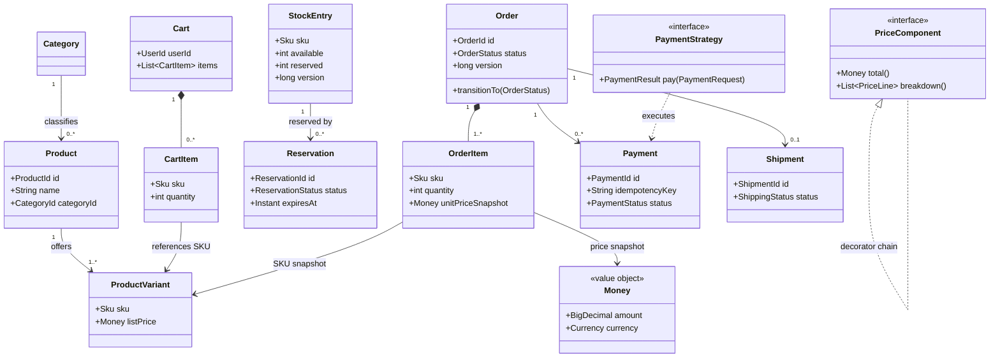
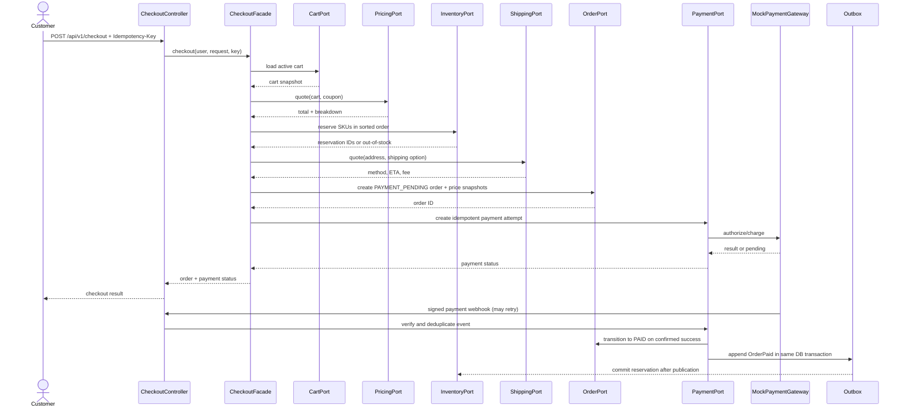

# Architecture Baseline

## Package Structure

```text
com.shop
├── catalog/{domain,application,infrastructure}
├── cart/{domain,application,infrastructure}
├── pricing/{domain,application,infrastructure}
├── inventory/{domain,application,infrastructure}
├── order/{domain,application,infrastructure}
├── payment/{domain,application,infrastructure}
├── shipping/{domain,application,infrastructure}
├── user/{domain,application,infrastructure}
├── notification/{domain,application,infrastructure}
└── shared
    ├── domain
    ├── application
    └── infrastructure
```

`domain` contains business types and rules without framework annotations. `application` contains use cases and ports. `infrastructure` contains Spring adapters, REST DTOs/controllers, persistence mappings, and configuration. The shared domain package is the only permitted cross-module domain dependency. `DomainArchitectureTest` enforces this rule.

## Class Diagram (Target Model)



## ER Diagram (Target Persistence Model)

```mermaid
erDiagram
    USERS ||--o{ ADDRESSES : has
    USERS ||--o| CARTS : owns
    CARTS ||--o{ CART_ITEMS : contains
    PRODUCTS ||--|{ PRODUCT_VARIANTS : offers
    CATEGORIES ||--o{ PRODUCTS : classifies
    PRODUCT_VARIANTS ||--o{ CART_ITEMS : selected_as
    PRODUCT_VARIANTS ||--o{ STOCK_ENTRIES : stocked_as
    STOCK_ENTRIES ||--o{ RESERVATIONS : tracks
    USERS ||--o{ ORDERS : places
    ORDERS ||--|{ ORDER_ITEMS : snapshots
    PRODUCT_VARIANTS ||--o{ ORDER_ITEMS : purchased_as
    ORDERS ||--o{ PAYMENTS : paid_by
    ORDERS ||--o| SHIPMENTS : fulfilled_by
    USERS ||--o{ PAYMENTS : initiates
    OUTBOX_EVENTS ||--o{ PROCESSED_EVENTS : delivered_as

    USERS {
      uuid id PK
      string email UK
      string password_hash
    }
    PRODUCTS {
      uuid id PK
      uuid category_id FK
      string name
      string status
    }
    PRODUCT_VARIANTS {
      uuid id PK
      uuid product_id FK
      string sku UK
      decimal list_price
      string currency
    }
    CARTS {
      uuid id PK
      uuid user_id FK
      bigint version
    }
    CART_ITEMS {
      uuid id PK
      uuid cart_id FK
      string sku FK
      int quantity
    }
    STOCK_ENTRIES {
      uuid id PK
      string sku FK
      string warehouse_id
      int available
      int reserved
      bigint version
    }
    RESERVATIONS {
      uuid id PK
      string sku FK
      uuid order_id
      int quantity
      string status
      timestamp expires_at
    }
    ORDERS {
      uuid id PK
      uuid user_id FK
      string status
      decimal total
      string currency
      bigint version
    }
    ORDER_ITEMS {
      uuid id PK
      uuid order_id FK
      string sku
      int quantity
      decimal unit_price_snapshot
      string currency
    }
    PAYMENTS {
      uuid id PK
      uuid order_id FK
      uuid user_id FK
      string idempotency_key
      string status
      string gateway_ref
    }
    SHIPMENTS {
      uuid id PK
      uuid order_id FK
      string status
      string tracking_number
    }
    OUTBOX_EVENTS {
      uuid id PK
      string aggregate_id
      string event_type
      json payload
      timestamp created_at
      timestamp published_at
    }
    PROCESSED_EVENTS {
      uuid consumer_id PK
      uuid event_id PK
      timestamp processed_at
    }
```



The diagram is conceptual; concrete constraints, indexes, and migration details will be introduced with the owning modules.

## Checkout Sequence (Target Flow)



The payment network call is not held inside a database transaction. A pending order and expiring stock reservation bridge the external call; webhook/reconciliation completes or compensates the workflow. This is a local saga, not a distributed transaction.